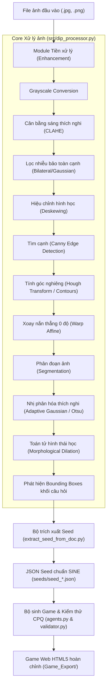

# KẾ HOẠCH NÂNG CẤP HỆ THỐNG SINE - MODULE XỬ LÝ ẢNH (DIP)
> **Đề tài:** Nâng cấp hệ thống tiếp nhận và xử lý đề thi dạng ảnh (`.jpg`, `.png`, `.jpeg`) phục vụ Bài tập lớn môn Xử lý ảnh (Digital Image Processing)  
> **Dự án gốc:** SINE (Serious Interactive Narrative Engine)  
> **Quy mô nhân sự:** 02 thành viên  

---

## 1. TỔNG QUAN & MỤC TIÊU DỰ ÁN

### 1.1. Hiện trạng hệ thống SINE
* **Đầu vào hiện tại:** Chỉ hỗ trợ file văn bản `.docx`, `.pdf`, `.txt`, `.md`.
* **Cơ chế hiện tại với ảnh scan:** Đối với PDF scan, hệ thống dùng `PyMuPDF` cắt ảnh thô rồi gửi trực tiếp qua Vision LLM (API black-box).
* **Vấn đề đối với môn Xử lý ảnh:** Việc đưa thẳng ảnh gốc vào AI/LLM không thể hiện kiến thức môn học. Bài tập lớn môn Xử lý ảnh đòi hỏi phải áp dụng các kỹ thuật xử lý ảnh kinh điển (tiền xử lý, lọc nhiễu, biến đổi hình học, phân đoạn ảnh, trích xuất đặc trưng).

### 1.2. Mục tiêu nâng cấp
1. **Xây dựng Pipeline DIP độc lập:** Tự động làm sạch, nắn thẳng và phân đoạn ảnh chụp đề thi thực tế (bị mờ, tối, nghiêng góc, bóng tay/điện thoại).
2. **Mở rộng định dạng đầu vào:** Hỗ trợ trực tiếp file ảnh chụp `.jpg`, `.jpeg`, `.png`, `.bmp` trên cả giao diện đồ họa (GUI) và dòng lệnh (CLI).
3. **Trực quan hóa thuật toán (DIP Dashboard):** Bổ sung giao diện xem trước từng bước xử lý ảnh để phục vụ việc demo và báo cáo trước giảng viên.
4. **Đánh giá định lượng khoa học:** Đo lường hiệu quả bằng các chỉ số toán học ($PSNR$, $SSIM$, độ chính xác phân đoạn và trích xuất câu hỏi).

---

## 2. KIẾN TRÚC LUỒNG XỬ LÝ (DIP + SINE PIPELINE)



---

## 3. PHÂN CÔNG VAI TRÒ (TEAM 2 NGƯỜI)

* **Thành viên A (DIP Algorithm Engineer - Kỹ sư Xử lý ảnh)**:
  * Phụ trách phát triển toàn bộ module thuật toán xử lý ảnh cốt lõi `src/dip_processor.py`.
  * Nghiên cứu, tối ưu hóa các thông số thuật toán: Bộ lọc, ma trận xoay, ngưỡng nhị phân, kernel hình thái học.
  * Phụ trách đo đạc các chỉ số kỹ thuật và vẽ biểu đồ thực nghiệm ($PSNR$, $SSIM$).

* **Thành viên B (System Integration & GUI Engineer - Kỹ sư Tích hợp & Giao diện)**:
  * Thu thập và chuẩn hóa tập dữ liệu ảnh chụp đề thi mẫu.
  * Nâng cấp `extract_seed_from_doc.py` để tích hợp `dip_processor.py`.
  * Nâng cấp giao diện `sine_gui.py` thêm cửa sổ trực quan hóa các bước xử lý ảnh (DIP Dashboard).
  * Viết tài liệu báo cáo kỹ thuật BTL và chuẩn bị slide thuyết trình.

---

## 4. BẢNG ĐẦU VIỆC CHI TIẾT (TASK LIST & CHECKLIST)

### MODULE 1: THUẬT TOÁN XỬ LÝ ẢNH CỐT LÕI
> **Phụ trách chính:** Thành viên A

- [x] **Task 1.1: Khởi tạo môi trường & Cấu trúc thư viện**
  - Cập nhật [requirements.txt](file:///e:/Chuyên đề nghiên cứu khoa học/SINE-Project/requirements.txt) thêm: `opencv-python`, `numpy`, `matplotlib`, `scikit-image`.
  - Khởi tạo file `src/dip_processor.py` chứa class `ImageDIPProcessor`.

- [x] **Task 1.2: Tiền xử lý & Nâng cao chất lượng ảnh (Image Enhancement)**
  - Chuyển đổi không gian màu: $RGB \rightarrow Grayscale$.
  - Khử nhiễu: Thử nghiệm `Bilateral Filter` ($d=9, \sigma_{color}=75, \sigma_{space}=75$) để khử nhiễu nền giấy mà không làm nhòe cạnh nét chữ.
  - Cân bằng sáng thích nghi: Cài đặt **CLAHE** (*Contrast Limited Adaptive Histogram Equalization*) với `clipLimit=2.0`, `tileGridSize=(8,8)` để xử lý ảnh bị loang lổ sáng/tối hoặc bóng mờ điện thoại.

- [x] **Task 1.3: Hiệu chỉnh hình học & Nắn thẳng văn bản (Geometric Deskewing)**
  - Dùng **Black Hat Transform** và **Canny Edge Detection** để trích xuất biên mép văn bản.
  - Sử dụng **Biến đổi Hough (Hough Line Transform)** để xác định góc nghiêng lệch $\theta$ của các dòng kẻ/dòng văn bản.
  - Tính ma trận xoay affine `cv2.getRotationMatrix2D`, nắn thẳng ảnh về góc $0^\circ$ (`cv2.warpAffine`) và auto-crop viền ngoài (loại bỏ bàn tay, nền đen).

- [x] **Task 1.4: Nhị phân hóa thích nghi (Binarization)**
  - Cài đặt **Adaptive Gaussian Thresholding** (`cv2.adaptiveThreshold` với `ADAPTIVE_THRESH_GAUSSIAN_C`) và **Otsu Thresholding**.
  - Tách triệt để mực chữ đen trên nền giấy trắng, loại bỏ nền bẩn.

- [x] **Task 1.5: Phân đoạn khối chữ & Đóng khung câu hỏi (Segmentation & Layout)**
  - Áp dụng toán tử giãn nở ngang `cv2.dilate` với cấu trúc kernel chữ nhật ngang để gom các ký tự thành từng dòng/khối văn bản.
  - Sử dụng `cv2.findContours` kết hợp Non-Maximum Suppression (NMS) để trích xuất tọa độ Bounding Boxes $(x, y, w, h)$ bao quanh từng câu hỏi.

- [x] **Task 1.6: Xây dựng công cụ đo lường chất lượng ảnh (Evaluation Metrics)**
  - Viết hàm tính **PSNR** (*Peak Signal-to-Noise Ratio*):
    $$PSNR = 10 \cdot \log_{10}\left(\frac{MAX_I^2}{MSE}\right)$$
  - Viết hàm tính **SSIM** (*Structural Similarity Index Measure*) bằng `scikit-image`.
  - Đo đạc No-Reference: Michelson Contrast, Tenengrad Gradient Sharpness, Background Uniformity.
  - Xây dựng công cụ tự động `tools/evaluate_dip_metrics.py` và tích hợp vào DIP Studio.
  - Tự động xuất báo cáo Markdown (`output/dip_evaluation_report.md`), file CSV và biểu đồ 4 ô (`output/dip_metrics_chart.png`).

---

### MODULE 2: TÍCH HỢP HỆ THỐNG & GIAO DIỆN NGƯỜI DÙNG
> **Phụ trách chính:** Thành viên B

- [ ] **Task 2.1: Thu thập và chuẩn hóa tập dữ liệu thử nghiệm (Dataset)**
  - Chuẩn bị thư mục `test_images/` gồm ít nhất 15-20 ảnh đề thi chụp thực tế:
    - Nhóm 1: Ảnh chụp chuẩn, đủ sáng (dùng làm baseline).
    - Nhóm 2: Ảnh chụp nghiêng góc ($10^\circ - 25^\circ$).
    - Nhóm 3: Ảnh chụp thiếu sáng, ngược sáng, bóng đổ điện thoại đè lên chữ.

- [x] **Task 2.2: Nâng cấp bộ trích xuất (`extract_seed_from_doc.py`)**
  - Mở rộng hàm kiểm tra định dạng file: Chấp nhận thêm `.jpg`, `.jpeg`, `.png`, `.bmp`.
  - Nối luồng xử lý: File ảnh $\rightarrow$ gọi `dip_processor.process_stage2()` $\rightarrow$ thu được ảnh đã nắn thẳng, làm sạch và tọa độ câu hỏi $\rightarrow$ trích xuất nội dung tạo `seeds/seed_<topic>_auto.json`.

- [x] **Task 2.3: Nâng cấp Giao diện giáo viên (`sine_gui.py`)**
  - Mở rộng bộ lọc `filedialog.askopenfilename`: Thêm các định dạng ảnh vào danh sách chọn file.
  - Xây dựng cửa sổ **"DIP Studio / Visualizer" (Xem trước các bước xử lý ảnh)**:
    - Hiển thị song song 4 bước trực quan:
      1. *Ảnh gốc chụp thực tế*
      2. *Ảnh sau khi khử nhiễu & CLAHE*
      3. *Ảnh sau khi nắn thẳng (Deskewed)*
      4. *Ảnh nhị phân đã phân đoạn đóng khung câu hỏi (ROI Bounding Boxes)*

- [x] **Task 2.4: Kiểm thử tích hợp toàn trình (End-to-End Pipeline)**
  - Đảm bảo quy trình 1-click mượt mà: Người dùng nạp ảnh $\rightarrow$ Xử lý ảnh $\rightarrow$ Trích xuất Seed $\rightarrow$ Sinh kịch bản Ink $\rightarrow$ Đóng gói ra game Web HTML5 trong thư mục `Game_Export/`.

---

### MODULE 3: BÁO CÁO BÀI TẬP LỚN & CHUẨN BỊ BẢO VỆ
> **Phụ trách chính:** Cả hai thành viên phối hợp

- [ ] **Task 3.1: Soạn thảo Báo cáo kỹ thuật BTL (Word/PDF)**
  - **Chương 1:** Giới thiệu bài toán nhận dạng và làm sạch đề thi từ ảnh chụp thực tế.
  - **Chương 2:** Cơ sở lý thuyết Xử lý ảnh số (Không gian màu, Lọc số, Cân bằng lược đồ mức xám CLAHE, Biến đổi Hough, Toán tử hình thái học).
  - **Chương 3:** Thiết kế kiến trúc và giải thuật chi tiết trong hệ thống SINE.
  - **Chương 4:** Đánh giá thực nghiệm (Bảng số liệu PSNR/SSIM, so sánh độ chính xác trích xuất giữa ảnh thô vs ảnh đã xử lý).
  - **Chương 5:** Kết luận và hướng phát triển.

- [ ] **Task 3.2: Thiết kế Slide thuyết trình & Kịch bản Demo**
  - Xây dựng slide trình chiếu (12–15 slide), tập trung vào ảnh minh chứng các bước thuật toán.
  - Chuẩn bị sẵn 2 kịch bản demo:
    - *Kịch bản 1:* Demo trực tiếp thuật toán xử lý ảnh trên ảnh chụp nghiêng/tối tại DIP Visualizer.
    - *Kịch bản 2:* Chạy 1-click từ ảnh đề thi ra tựa game nhập vai giáo dục hoàn chỉnh.

---

## 5. CÁC BƯỚC BẮT ĐẦU NGAY (QUICK START)

1. **Cài đặt thư viện xử lý ảnh:**
   ```powershell
   pip install opencv-python numpy matplotlib scikit-image
   ```

2. **Cấu trúc thư mục mới sau khi nâng cấp:**
   ```text
   SINE-Project/
   ├── src/
   │   ├── dip_processor.py       <-- [MỚI] Module thuật toán xử lý ảnh cốt lõi
   │   ├── agents.py              <-- AI Generator & Fixer
   │   └── validator.py           <-- Bộ kiểm thử tự động CPQ
   ├── test_images/               <-- [MỚI] Thư mục chứa ảnh chụp đề thi mẫu
   ├── extract_seed_from_doc.py   <-- [CẬP NHẬT] Hỗ trợ nạp file .jpg, .png
   ├── sine_gui.py                <-- [CẬP NHẬT] Thêm bộ lọc ảnh & DIP Dashboard
   ├── requirements.txt           <-- [CẬP NHẬT] Thêm opencv-python, scikit-image
   └── KE_HOACH_NANG_CAP_XU_LY_ANH.md
   ```
